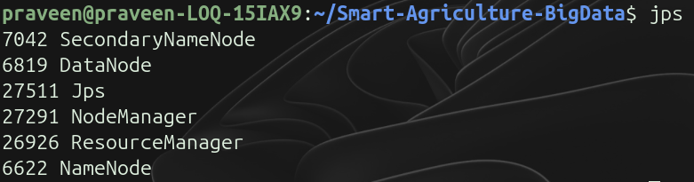
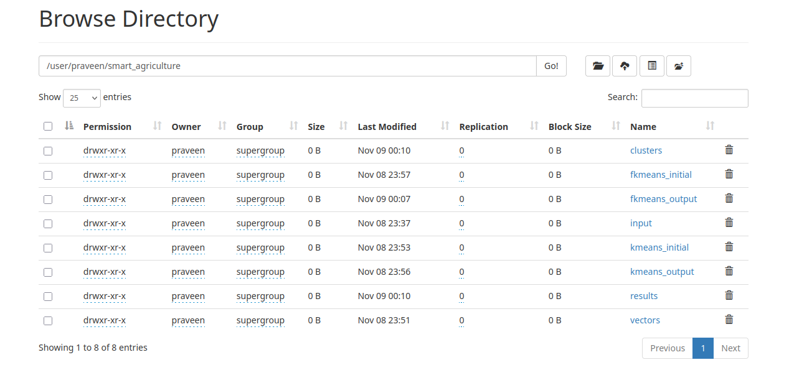
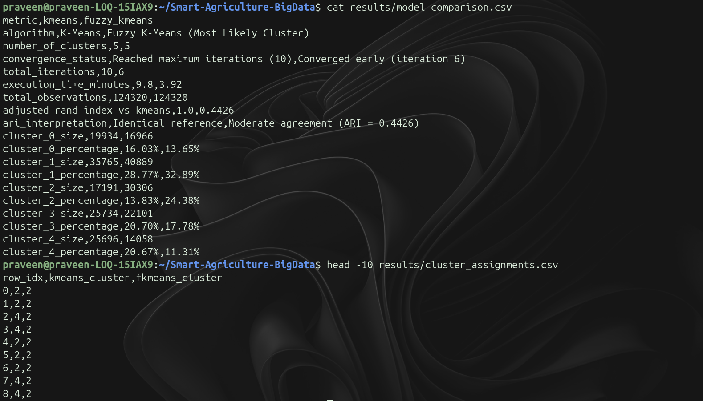
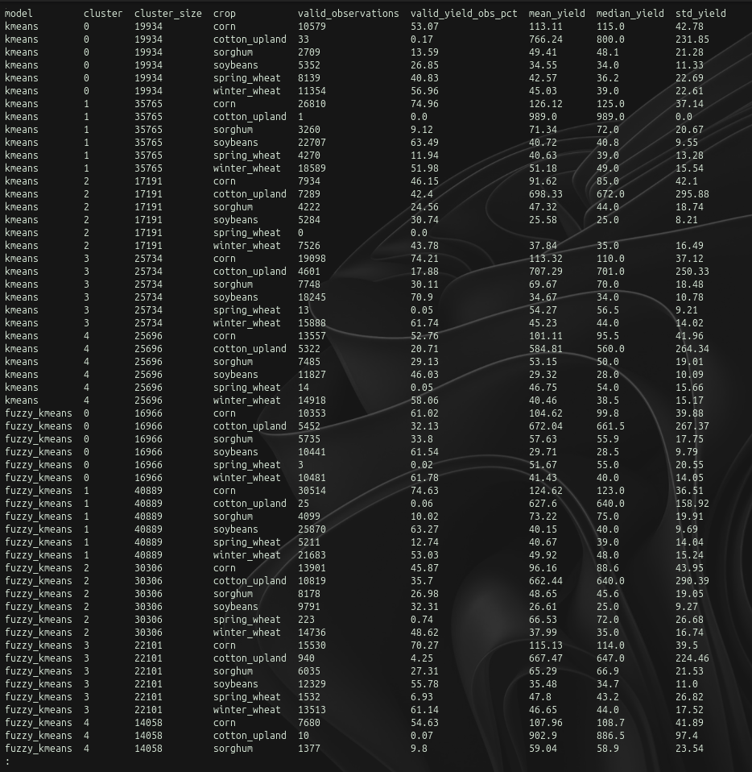

# Smart Agriculture Big Data Analytics Using Hadoop and Apache Mahout

This project uses agricultural data to study how weather and soil conditions vary across different US counties and years. We used Hadoop and Mahout to prepare the data and apply K-Means and Fuzzy K-Means clustering.

## Dataset
We used the **Cornell USCrop dataset** (1981–2020), which contains 124,320 county-year records and 6,322 columns containing identifiers, crop yields, and environmental measurements.
- Dataset source: https://ecommons.cornell.edu/entities/publication/867a510e-9a59-4466-9f56-1a3a432b200e
- Extracted data: `data/extracted/data.npy` (5.9 GB)
- Features selected for clustering: 1,322 continuous features (PRISM weather, NLDAS land surface, and gSSURGO soil properties)
- Preserved separately: County FIPS, year, and 6 USDA crop yields (corn, cotton, sorghum, soybeans, spring wheat, winter wheat)
- Excluded: 4,992 weekly crop-progress survey features due to over 93% missing values

## Technologies Used
- Ubuntu Linux
- Apache Hadoop 3.3.6 (HDFS and YARN)
- Apache Mahout 0.13.0
- Python 3 with NumPy

## Project Structure

```
Smart-Agriculture-BigData/
├── data/       # Raw, processed, and sample dataset files
├── docs/       # Project methodology and screenshot placeholders
├── reports/    # Final project report
├── results/    # Clustering outputs, model metrics, and crop yield analysis
├── src/        # Python data processing scripts and Mahout shell scripts
└── README.md   # Project overview, results, and instructions
```

## Main Steps Followed
1. Inspected the dataset and checked missing values across feature groups.
2. Selected 1,322 weather and soil features and excluded sparse survey columns.
3. Handled missing values using column mean imputation and scaled features to [0, 1].
4. Copied the data to HDFS and converted text lines into Mahout SequenceFiles.
5. Ran K-Means and Fuzzy K-Means clustering on Hadoop using $k=5$.
6. Evaluated cluster sizes, runtimes, and compared cluster assignments with crop yields.

## Algorithms Used
- **K-Means Clustering:** Hard clustering where each observation belongs to one cluster.
- **Fuzzy K-Means Clustering:** Soft clustering where points have membership across clusters, with each observation assigned to its most likely cluster for comparison.

## Results Summary

| Metric | K-Means | Fuzzy K-Means |
| :--- | :---: | :---: |
| Number of Clusters ($k$) | 5 | 5 |
| Iterations | 10 | 6 |
| Execution Time | ~9.80 minutes | ~3.92 minutes |
| Observations Processed | 124,320 | 124,320 |
| Cluster 0 Size | 19,934 (16.0%) | 16,966 (13.7%) |
| Cluster 1 Size | 35,765 (28.8%) | 40,889 (32.9%) |
| Cluster 2 Size | 17,191 (13.8%) | 30,306 (24.4%) |
| Cluster 3 Size | 25,734 (20.7%) | 22,101 (17.8%) |
| Cluster 4 Size | 25,696 (20.7%) | 14,058 (11.3%) |
| Adjusted Rand Index (ARI) | — | 0.4426 |

For comparison, each Fuzzy K-Means observation was assigned to its most likely cluster. The Adjusted Rand Index of 0.4426 indicates moderate agreement between the K-Means and Fuzzy K-Means assignments, rather than model accuracy. Linking the clusters to the preserved crop yields showed clear differences: for example, Cluster 1 had the highest average corn yields (126.1 bu/acre), Cluster 2 had the largest number of valid cotton yield records, while Cluster 0 had the largest number of valid spring wheat yield records.

## Project Documentation
- [Final Project Report](reports/final_report.md) — Final project report covering preprocessing, Hadoop and Mahout setup, clustering results, and agricultural crop-yield analysis.
- [Methodology](docs/methodology.md) — Project methodology and implementation details for the Big Data clustering pipeline.

## Screenshots

### Hadoop Services Running
  
*Hadoop services running on the system.*

### Overall HDFS Directory Structure
  
*HDFS directory structure showing the input, vectors, clusters, and results folders.*

### Model Evaluation Results
  
*Comparison of K-Means and Fuzzy K-Means results, including execution time and cluster sizes.*

### Crop-Yield Analysis
  
*Crop-yield analysis across the clusters.*

## How to Run the Project

> **Notes:**
> - The original dataset must be available before running preprocessing.
> - When rerunning conversion or clustering, previous HDFS output directories may need to be removed first to avoid existing-output errors (e.g., using `hdfs dfs -rm -r <path>`).

1. Start Hadoop services:
   ```bash
   /usr/local/hadoop/sbin/start-dfs.sh
   /usr/local/hadoop/sbin/start-yarn.sh
   ```

2. Run preprocessing:
   ```bash
   python3 src/analysis/select_features.py
   python3 src/analysis/preprocess.py
   ```

3. Upload data to HDFS and convert to SequenceFiles:
   ```bash
   hdfs dfs -mkdir -p /user/praveen/smart_agriculture/input
   tr ',' ' ' < data/processed/clustering_data.csv | \
     hdfs dfs -put - /user/praveen/smart_agriculture/input/clustering_data.txt

   MAHOUT_LOCAL="" mahout org.apache.mahout.clustering.conversion.InputDriver \
     -i /user/praveen/smart_agriculture/input/ \
     -o /user/praveen/smart_agriculture/vectors/ \
     -v org.apache.mahout.math.DenseVector
   ```

4. Run clustering scripts:
   ```bash
   bash src/mahout/run_kmeans.sh
   bash src/mahout/run_fuzzy_kmeans.sh
   ```

5. Run evaluation:
   ```bash
   python3 src/analysis/evaluate_models.py
   ```
